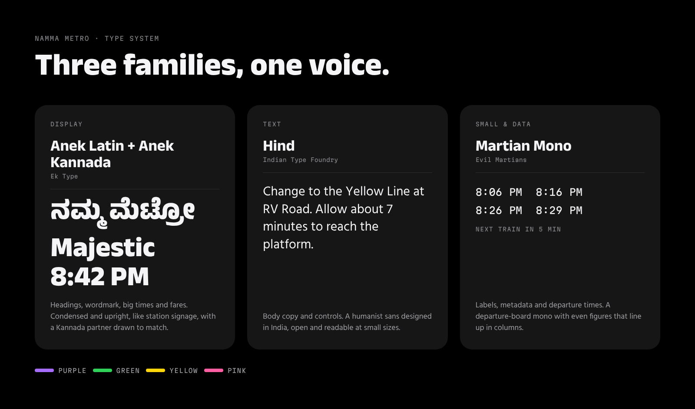

# Namma Metro Trip Planner

React + Vite + TypeScript app for planning Bengaluru Namma Metro trips.

## Setup

```bash
npm install
npm run dev
```

Then open http://localhost:5173

## Build

```bash
npm run build
npm run preview
```

## Project Structure

```
src/
  data/
    lines.ts         # Station lists + line metadata (colour, length, fare chart, aliases)
    timetable.ts     # Headway windows per line/direction for Monday / Tue–Fri / Saturday / Sunday
  utils/
    network.ts       # Network graph + shortest-route finder (any number of lines/interchanges)
    schedule.ts      # Schedule detection, next/last trains at a station, journey timing
    fare.ts          # Distance-slab fares + official per-line fare charts
  hooks/index.ts     # useClock, usePersistentState, useTheme (dark/light)
  components/
    GlobalNav.tsx    # Sticky nav: wordmark, live clock, theme toggle
    Planner.tsx      # From/To fields, swap, leave now/later, holiday toggle
    StationPicker.tsx# Searchable station sheet (all lines, aliases, recents, keyboard nav)
    JourneyView.tsx  # Journey summary + step-by-step itinerary
    FareCard.tsx     # Fare estimate
    Home.tsx         # Empty state: popular trips + network tiles
    NetworkMap.tsx   # Schematic network map (hero illustration)
    Footer.tsx       # Footnotes (accuracy, fares) + credits
    ui.tsx           # Line badges/tags, icons
  App.tsx            # State, URL/localStorage sync, layout
  index.css          # Design tokens (dark + light) and component styles
```

## Features

- **One search across all lines**: type any station (nicknames like "majestic", "silk board" and "ecity" work). The app picks the lines and interchanges for you.
- **Automatic routing**: a shortest-path search over the whole network handles direct, 1-, 2- and 3-change trips (e.g. Pink → Yellow → Green → Purple).
- **Purple, Green, Yellow and Pink lines**: Pink Line covers the operational elevated stretch (Kalena Agrahara ⟷ S G Palya) with its official fare chart.
- **Realistic board times**: train times account for how far your station is from the terminus.
- **Plans from right now**: weekday, Monday, Saturday, 2nd/4th Saturday and Sunday timetables are detected automatically, and a holiday toggle switches to the Sunday timetable.
- **Last-train awareness**: shows the last train from each boarding point; if service has ended, it plans the first trains next morning.
- **Itinerary**: the next 4 trains per leg, intermediate stops on demand, and interchange walk time.
- **Fare estimate**: token/QR and smart-card fares.
- **Shareable links**: the route is kept in the URL (`?from=…&to=…`) and remembered between visits.
- **Dark by default with a light mode**: toggle in the top bar, remembered per device and applied before first paint.
- **Accessible**: semantic landmarks, skip link, labelled controls, visible focus, keyboard-operable station search, WCAG AA text contrast, reduced-motion support.

## Design system

All tokens live at the top of `src/index.css` (colours per theme, type scale, radii, motion).



| Role | Font | Foundry | Used for |
| --- | --- | --- | --- |
| Display | Anek Latin + Anek Kannada | Ek Type | Headings, the bilingual wordmark, large times and fares |
| Text | Hind | Indian Type Foundry | Body copy and controls |
| Small & data | Martian Mono | Evil Martians | Labels, metadata, departure times |

Display and mono use their variable width axes (condensed, signage-like) via `--display-width` and `--mono-width`.

### Brand images

`public/` holds the app icon set (`icon-512.png`, `icon-192.png`, `apple-touch-icon.png`, `favicon-32.png`), the social preview (`og-image.png`) and the web app manifest. They are generated by `scripts/generate-brand-assets.cjs` (needs Playwright):

```bash
npx playwright install chromium
node scripts/generate-brand-assets.cjs
```

The hero network map is an inline SVG component (`src/components/NetworkMap.tsx`) that follows the theme and highlights the lines used by the planned trip.

Line colours are theme tokens (`--line-purple`, `--line-green`, `--line-yellow`, `--line-pink`), so add one there when adding a line.

## Adding a line

1. Add the key to `LineKey` and its ordered stations to `LINES` in `src/data/lines.ts`.
2. Add a `LINE_META` entry (colour, length, minutes per stop, optional `fareTable`).
3. Add `<line>_fwd` / `<line>_rev` windows to every schedule in `src/data/timetable.ts`.

Interchanges are detected from shared station names; routing, search, fares and the UI update automatically.
